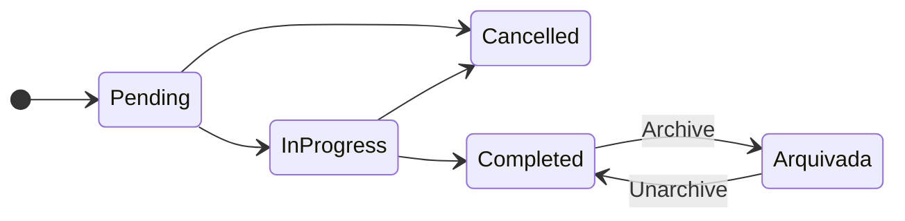

<div align="center">
  

  # Task Manager — API

  API REST para criar, acompanhar e arquivar tarefas com prioridade, prazo e status.

  [](https://github.com/aqu1no1/dotnet-task-manager-api/actions/workflows/ci.yml)
</div>

## Sobre

Backend do Task Manager, consumido pelo [front-end em Angular](https://github.com/aqu1no1/angular-task-manager-web). Cada tarefa tem título, descrição, prioridade (`Low`, `Medium`, `High`) e prazo opcional. Ela começa como pendente, passa a em andamento e termina concluída ou cancelada. As concluídas podem ser arquivadas, e uma tarefa que passa do prazo sem terminar fica marcada como atrasada.

**Tecnologias:** `C#` · `ASP.NET Core 10` · `Entity Framework Core 10` · `PostgreSQL 17` · `Docker Compose` · `OpenAPI`

## Fluxo de status



## Como executar

Pré-requisitos: .NET SDK 10 e Docker Compose.

```bash
cp .env.example .env          # defina POSTGRES_PASSWORD
docker compose up -d db
dotnet restore
ConnectionStrings__DefaultConnection='Host=localhost;Port=5433;Database=task_manager_db;Username=task_manager;Password=sua_senha_local' \
  dotnet run --project src/TaskManager.Api
```

> O ASP.NET Core não lê o `.env`, por isso a connection string vai no ambiente. Em desenvolvimento, o contrato OpenAPI fica em `/openapi/v1.json`.

## Estrutura

| Caminho | O que tem |
| --- | --- |
| `src/TaskManager.Api` | Aplicação ASP.NET Core: modelos, `DbContext` e configurações EF Core |
| `tests/TaskManager.UnitTests` | Testes unitários das regras de domínio |
| `tests/TaskManager.IntegrationTests` | Testes de persistência contra PostgreSQL |
| `docs/` | Documentação técnica |

## Documentação

| Página | O que tem |
| --- | --- |
| [Arquitetura](docs/arquitetura.md) | Camadas, responsabilidades e decisões do MVP |
| [Workflow .NET](docs/workflow-dotnet.md) | Execução local, migrations, testes e ciclo de mudança |
| [CI e releases](docs/ci-releases.md) | Pipelines, release manual e branch protection |
| [Changelog](CHANGELOG.md) | Histórico de versões |

## Referências

- [ASP.NET Core — Documentação](https://learn.microsoft.com/aspnet/core/)
- [Entity Framework Core — Documentação](https://learn.microsoft.com/ef/core/)
- [Npgsql EF Core Provider](https://www.npgsql.org/efcore/)
- [PostgreSQL 17 — Documentação](https://www.postgresql.org/docs/17/)
- [Design do Task Manager](https://github.com/aqu1no1/designs/tree/main/task-manager)
